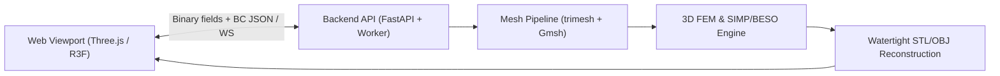

# Topo_Logic

**`Topo_Logic`** is an open-source web application for **3D Finite Element Analysis (FEM)** and **3D Topology Optimization** designed around real engineering CAD/mesh workflows (`.STL`, `.OBJ`, `.PLY`, `.STEP`).

> **Project Status:** Phase 0 — Environment, engineering specifications, reference library, and open-source repository foundation complete. Application implementation begins next.

---

## Vision & Core Capabilities (Planned Architecture)

1. **3D Model Ingestion & Volumetric Meshing**
   - Upload binary/ASCII `.STL`, `.OBJ`, `.PLY`, and `.STEP` geometries directly in the browser.
   - Automatic unit-scale sanity checking (`mm / N / MPa` vs `m / N / Pa`), watertight repair, normal fixing, and volumetric meshing (tetrahedral `C3D4`/`C3D10` via Gmsh and voxel grids for fast topology optimization).
2. **Interactive 3D CAE Viewport (`Three.js` / `React Three Fiber`)**
   - Dihedral-angle flood-fill patch selection on triangulated meshes so users can click entire planar faces or cylindrical bores to assign supports, loads, and non-design regions.
   - Linear-space scientific colormaps (Von Mises stress, displacement magnitude, safety factor), deformed mesh overlay with ghost wireframe, XYZ clipping planes, and live streaming previews.
3. **3D FEM & Topology Optimization Engine (`Python / SciPy / scikit-fem / FastAPI`)**
   - Linear static 3D elasticity solver verified against analytical patch and cantilever benchmarks.
   - 3D SIMP / BESO topology optimization with cone density/sensitivity filtering, Optimality Criteria (OC) and MMA updates, passive solid/void domains, and smooth watertight `.STL`/`.OBJ`/`.GLB` reconstruction.

---

## Repository Layout (Phase 0)

- [`AGENTS.md`](./AGENTS.md) — Engineering guidelines, active MCP/skill routing, and strict MIT license rules.
- [`.agents/skills/`](./.agents/skills/) — Project-specific engineering specifications:
  - `stl-obj-mesh-pipeline` — Mesh repair, unit guards, Gmsh meshing, and surface-to-volume mapping.
  - `fem-topopt-engine` — 3D linear static FEM, SIMP/BESO formulation, isosurface extraction, and benchmarks.
  - `threejs-fem-viewport` — Interactive CAE raycasting, stress shaders, clipping planes, and GPU lifecycle.
- [`CONTRIBUTING.md`](./CONTRIBUTING.md) & [`CODE_OF_CONDUCT.md`](./CODE_OF_CONDUCT.md) — Contribution and community standards.

---

## Inspirational Open-Source Ecosystem

`Topo_Logic` builds upon ideas and permissive open-source tooling from the computational mechanics and web graphics communities:

- [ToPy](https://github.com/williamhunter/topy) (MIT) — 3D stiffness templates, filters, and topology optimization benchmarks
- [PyTopo3D](https://github.com/jihoonkim888/PyTopo3D) (MIT) — 3D SIMP workflows with `.STL` design-space and obstacle support
- [pyMOTO](https://github.com/aatmdelissen/pyMOTO) (MIT) — Modular Python topology optimization, OC/MMA optimizers, and stress aggregation
- [scikit-fem](https://github.com/kinnala/scikit-fem) (BSD-3-Clause) — Pure Python/SciPy unstructured finite element assemblers
- [TopOpt_in_PETSc](https://github.com/topopt/TopOpt_in_PETSc) (LGPL-2.1, algorithmic reference) — Large-scale 3D PDE filtering and continuation concepts
- [Gmsh](https://gmsh.info/) & [Three.js](https://threejs.org/) (MIT)

---

## License

Released under the [MIT License](./LICENSE).
