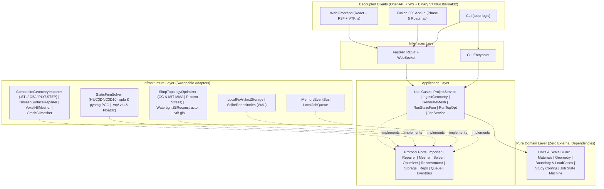

# Topo_Logic

[](./LICENSE)
[](https://www.python.org/)
[](./docs/arquitectura.md)

**`Topo_Logic`** is an open-source (**MIT**) computational mechanics platform for **3D Finite Element Analysis (FEM)** and **3D Topology Optimization**, architected as a decoupled **Python core engine + FastAPI backend** serving multiple clients (a future Web 3D CAE Viewport, CLI workflows, and a planned **Autodesk Fusion 360 Add-In**).

> **Current Status:** **Milestone 4 Complete (`v0.4.0a0`)** — Binary Scientific Exchange Formats (`.vtp`, `.vti`, `.vtu`, `.glb`), Multi-Format CAD Ingestion (`.STL`, `.OBJ`, `.PLY`, `.STEP`), and Full **React 19 + TypeScript + R3F + VTK.js + Recharts** Web CAE Frontend (`frontend/`, managed via `pnpm`) implemented and verified. Phase 5 (Fusion 360 Add-In & Cloud Adapters) is next.

---

## Project Progress Tracker

| Phase | Milestone | Status | Summary |
| :--- | :--- | :--- | :--- |
| **Phase 0** | Repository & Engineering Setup | **Done** | MIT license, `AGENTS.md`, engineering skills, read-only mechanics reference catalog |
| **Phase 1** | **Architecture Foundation & `.STL` Vertical Slice** | **Done** | Hexagonal architecture, pure domain (multi-loadcase FEM + OC/MMA stress TopOpt + `WeightSavingsMetrics`), `.STL` diagnostics & Tier-1 repair, SQLite + LocalFS, FastAPI (`/api/v1/materials`, upload/download, WS) + CLI, Spanish `docs/` + ADRs |
| **Phase 2** | **3D Linear Static FEM Engine** | **Done** | Pure-NumPy `H8` Z-column parity voxelizer & optional `Gmsh` CLI `C3D4`/`C3D10` adapter, consistent `Q4`/`T6`/`T3` traction integration, vectorized sparse assembly, Direct (`splu`) & `pyamg` PCG solvers, Von Mises / displacement / safety factor / equilibrium checks, `Float32` binary field endpoints, and analytical benchmarks |
| **Phase 3** | **3D Topology Optimization (SIMP + OC/MMA)** | **Done** | Sparse `cKDTree` cone & Heaviside projection filters, multi-loadcase compliance (`OC`), MIT `pyMOTO`-adapted `MMA` + relaxed P-norm Von Mises stress adjoints, passive solid/void `DesignZone`s, live `topopt.iteration` WS events, `Float32` density endpoint, zero-halo Marching Cubes + Taubin watertight `.STL` export, and FD/KKT/benchmark verification |
| **Phase 4** | **Multi-Format CAD, Binary Exchange & Web Frontend** | **Done** | Pure-MIT VTK XML (`.vtp`, `.vti`, `.vtu`) + `.glb` binary exporters, `.OBJ`/`.PLY`/`.STEP` importers, persisted TopOpt history, and React 19 + TS + Tailwind v4 + R3F (BVH flood-fill) + VTK.js (warp, XYZ clipping, probe, `ImageMarchingCubes`) + Recharts convergence/compare UI with off-React memory registry (`pnpm`) |
| **Phase 5** | **Fusion 360 Add-In & Cloud Adapters** | **Planned** | Hybrid-API Python Fusion 360 Add-In (`CadFaceTagSelector`, local/remote server mode, live Palette, MeshBody re-import) + S3/Postgres/Redis Cloud adapters |

See [`ROADMAP.md`](./ROADMAP.md) for the full multi-phase technical plan and [`CHANGELOG.md`](./CHANGELOG.md) for release notes.

---

## Architecture Overview

`Topo_Logic` enforces **Clean / Hexagonal Architecture (Ports & Adapters)** with **Local-First, Cloud-Ready** infrastructure:



---

## Core Engineering Capabilities

- **3D Surface Ingestion & Repair (`.STL`, `.OBJ`, `.PLY`, `.STEP` — `v0.4.0a0` Operational)**:
  - Binary/ASCII `.STL`, `.OBJ`, `.PLY` via MIT `trimesh` plus optional external `Gmsh` CLI `.STEP`/`.STP` tessellation; tolerance-based vertex merging, degenerate/duplicate face cleanup, hole filling, normal/winding repair, watertightness & non-manifold edge audit, automatic unit-scale sanity checks (`mm_N_MPa` vs. `m_N_Pa`), and glTF 2.0 (`.glb`) viewport preview export.
- **Client-Agnostic Boundary Conditions & Multi-Loadcase Domain**:
  - `TriangleSetSelector` (Web viewport BVH dihedral flood-fill), `PlaneSelector` & `BoundingBoxSelector` (CLI & analytical benchmarks), and `CadFaceTagSelector` (`.STEP` & Fusion 360 B-Rep faces).
  - Supports multiple weighted `LoadCase` definitions and non-design solid/void `DesignZone` tags.
- **3D FEM, SIMP Topology Optimization & Dual Web CAE Viewport (`v0.2.0a0`–`v0.4.0a0` Operational)**:
  - Isotropic material library (`GET /api/v1/materials`: `Steel AISI 1020`, `Aluminum 6061-T6`, `Titanium Ti-6Al-4V`, `PLA`, `PETG`) with automatic unit conversion.
  - 3D Linear Static FEM (`H8`, `C3D4`, `C3D10`) with Direct (`splu`) & `pyamg` PCG solvers, Von Mises / safety factor / equilibrium checks, and binary `.vtp`, `.vtu`, and `Float32` fields.
  - 3D SIMP Topology Optimization supporting **Optimality Criteria (OC)** compliance minimization and MIT-licensed **MMA + P-norm Von Mises stress-constrained** optimization, sparse `cKDTree` cone + Heaviside filtering, unit-consistent `WeightSavingsMetrics` (`g`, `kg`, `%`), live `topopt.iteration` WebSocket streaming + persisted history, `.vti` 3D density grids, `.vtu`, `.glb`, and watertight Marching Cubes + Taubin `.STL` reconstruction.
  - Decoupled **Web CAE Frontend** (`frontend/`, managed with `pnpm`): React 19, TypeScript, Tailwind CSS v4, shadcn/ui, React Three Fiber + `three-mesh-bvh`, VTK.js (`vtkWarpVector`, XYZ clipping, point probe, `vtkImageMarchingCubes`), Zustand UI metadata stores + off-React `SceneResourceRegistry`, TanStack Query, and Recharts live/comparative convergence plots.

---

## Quickstart (Local Development)

### 1. Create a Virtual Environment & Install (Python 3.11+)

```powershell
# Using Python 3.12
python3.12 -m venv .venv
.\.venv\Scripts\pip.exe install -e ".[dev]"
```

### 2. Inspect CLI & Start the Backend API

```powershell
.\.venv\Scripts\topo-logic.exe info
.\.venv\Scripts\topo-logic.exe serve --host 127.0.0.1 --port 8000
```

Interactive OpenAPI / Swagger documentation is available at `http://127.0.0.1:8000/docs`.

### 3. Run the Web CAE Frontend (`pnpm`)

```powershell
cd frontend
pnpm install --frozen-lockfile
pnpm run dev
```

Vite serves the Web CAE app at `http://127.0.0.1:5173` and proxies `/api` and `/ws` requests to `http://127.0.0.1:8000`.

### 4. Run Quality Checks & Tests

```powershell
# Backend
.\.venv\Scripts\pytest.exe -v
.\.venv\Scripts\mypy.exe src/topo_logic
.\.venv\Scripts\ruff.exe check src tests

# Frontend (inside frontend/)
pnpm run typecheck
pnpm run lint
pnpm run test
pnpm run build
# Full browser E2E (playwright.config.ts starts/stops backend + Vite automatically)
pnpm run test:e2e
```

---

## Technical Documentation (Spanish / Documentación de Mantenimiento)

Comprehensive architecture, mathematical, API, and maintenance guides are maintained in Spanish under [`docs/`](./docs/README.md):

- [`docs/README.md`](./docs/README.md) — Documentation index & onboarding guide
- [`docs/arquitectura.md`](./docs/arquitectura.md) — Hexagonal architecture, design patterns, dependency rules, and Local-to-Cloud migration guide
- [`docs/flujo-ingenieria.md`](./docs/flujo-ingenieria.md) — Unit consistency, `.STL` repair pipeline, 3D FEM, SIMP (OC/MMA + P-norm stress), and watertight reconstruction
- [`docs/contrato-api.md`](./docs/contrato-api.md) — Client-agnostic REST, WebSocket, and binary `Float32` contracts
- [`docs/integracion-fusion360.md`](./docs/integracion-fusion360.md) — Architecture blueprint for the future Hybrid-API Fusion 360 Add-In
- [`docs/guia-mantenimiento.md`](./docs/guia-mantenimiento.md) — Developer handbook & step-by-step extension recipes
- [`docs/adr/`](./docs/adr/0001-arquitectura-hexagonal-python.md) — Architecture Decision Records (`0001`–`0005`)

---

## Inspirational Open-Source Ecosystem & License Hygiene

`Topo_Logic` is released under the [**MIT License**](./LICENSE). To preserve clean MIT licensing for all downstream users, reusable code is adapted solely from permissive **MIT / BSD** libraries (`ToPy`, `PyTopo3D`, `pyMOTO`, `scikit-fem`, `trimesh`, `pyamg`), while copyleft projects (`TopOpt_in_PETSc` LGPL-2.1, `mmapy` GPL-3.0) serve strictly for conceptual algorithmic study. Optional `Gmsh` meshing in Phase 2 runs exclusively as an external CLI subprocess adapter.
