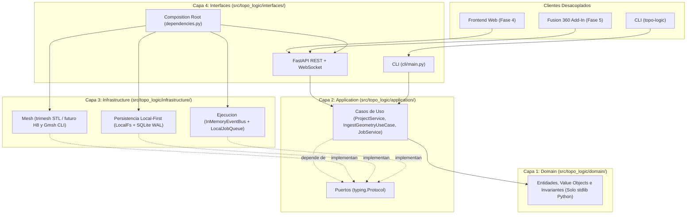

# Arquitectura de `Topo_Logic`

`Topo_Logic` está diseñado bajo **Arquitectura Limpia / Hexagonal (Ports & Adapters)** en **Python 3.12+**, con el objetivo de mantener la lógica de mecánica computacional completamente aislada de frameworks web, bases de datos, sistemas de archivos y clientes gráficos (Frontend Web, CLI y futuro Add-In de Fusion 360).

---

## 1. Principio Rector: Motor Agnóstico + Clientes Desacoplados

---

## 2. Regla de Dependencias y Verificación Automatizada

Las dependencias de importación apuntan **estrictamente hacia adentro**:

| Capa | Ruta | Puede importar | Prohibido importar |
| :--- | :--- | :--- | :--- |
| **1. Domain** | `src/topo_logic/domain/` | Exclusivamente biblioteca estándar de Python (`dataclasses`, `enum`, `math`, `datetime`, `typing`, `uuid`) | `fastapi`, `pydantic`, `trimesh`, `numpy`, `scipy`, `sqlite3`, `application`, `infrastructure`, `interfaces` |
| **2. Application** | `src/topo_logic/application/` | Stdlib + `topo_logic.domain` + `topo_logic.application` | `fastapi`, `pydantic`, `trimesh`, `numpy`, `scipy`, `sqlite3`, `infrastructure`, `interfaces` |
| **3. Infrastructure** | `src/topo_logic/infrastructure/` | `domain`, `application.ports`, librerías científicas/IO (`trimesh`, `numpy`, `scipy`, `sqlite3`, `pydantic-settings`) | `interfaces`, `fastapi` |
| **4. Interfaces** | `src/topo_logic/interfaces/` | `domain`, `application`, `fastapi`, `pydantic` (y `infrastructure` únicamente en el *Composition Root* `dependencies.py` y `cli/main.py`) | Lógica numérica o SQL directa dentro de routers HTTP |

> **Prueba automatizada de arquitectura:** El archivo [`tests/unit/test_architecture_boundaries.py`](../tests/unit/test_architecture_boundaries.py) inspecciona mediante el módulo `ast` todos los archivos Python de `domain`, `application` e `infrastructure` en cada ejecución de `pytest`. Cualquier violación de límites hace fallar la suite de pruebas inmediatamente.

---

## 3. Patrones de Diseño Aplicados

### 3.1. Ports & Adapters (Arquitectura Hexagonal)
Toda dependencia externa vive detrás de un `typing.Protocol` en `src/topo_logic/application/ports/`:
- `geometry.py`: `GeometryImporterPort`, `MeshRepairPort`, `VolumetricMesherPort`.
- `simulation.py`: `LinearSystemSolverPort`, `FemSolverPort`, `DensityFilterPort`, `OptimizerPort`, `SurfaceReconstructorPort`.
- `persistence.py`: `ArtifactStoragePort`, `ProjectRepositoryPort`, `GeometryRepositoryPort`, `JobRepositoryPort`.
- `execution.py`: `CancellationToken`, `EventPublisherPort`, `JobQueuePort`.

### 3.2. Strategy Pattern
Los algoritmos intercambiables implementan un mismo puerto para crecer sin modificar casos de uso:
- **Importadores de geometría:** Fase 1 usa `TrimeshStlImporter` (`.STL`). Fase 4 añadirá importadores para `.OBJ`, `.PLY` y `.STEP` bajo `GeometryImporterPort`.
- **Malladores volumétricos (Fase 2):** `VoxelH8Mesher` (100% MIT) vs. `GmshCliTetMesher` (`C3D10` por subproceso).
- **Solvers lineales (Fase 2):** Directo (`spsolve`) para mallas pequeñas/medianas vs. `PyAmgPcgSolver` para mallas grandes.
- **Optimizadores (Fase 3):** `OcOptimizer` (compliance rápido) vs. `MmaOptimizer` (multi-restricción con tensión P-norma).

### 3.3. Value Objects Polimórficos (`RegionSelector`)
En lugar de acoplar las condiciones de contorno a índices de triángulos de Three.js o a caras B-Rep de Fusion 360, `src/topo_logic/domain/boundary.py` define una unión discriminada de selectores:
- `TriangleSetSelector`: selección interactiva en viewport Web (flood-fill por ángulo diedro).
- `PlaneSelector` / `BoundingBoxSelector`: selección geométrica para CLI y benchmarks analíticos.
- `CadFaceTagSelector`: selección por ID persistente de cara B-Rep para `.STEP` y el **Plugin de Fusion 360**.

### 3.4. Composition Root Explícito
El ensamblaje completo de adaptadores concretos se concentra en `build_container(settings)` dentro de [`src/topo_logic/interfaces/api/dependencies.py`](../src/topo_logic/interfaces/api/dependencies.py). En pruebas o despliegues alternativos basta sustituir adaptadores en un único punto.

### 3.5. Máquina de Estados Inmutable (`JobRecord`) y Cancelación Cooperativa
`src/topo_logic/domain/jobs.py` define transiciones legales explícitas (`ALLOWED_JOB_TRANSITIONS`) e impide saltos inválidos mediante `InvalidJobTransitionError`. Los workers consultan `CancellationToken.is_cancelled()` en cada iteración del solver/optimizador y publican eventos por `EventPublisherPort`.

---

## 4. Ruta de Migración Local-First → Cloud

| Capacidad | Implementación Local-First (Actual) | Implementación Cloud (Fase 5) | Puerto en `application/ports/` |
| :--- | :--- | :--- | :--- |
| Almacenamiento de mallas y campos `Float32` | `LocalFsArtifactStorage` (disco local atómico) | `S3ArtifactStorage` (AWS S3 / MinIO) | `ArtifactStoragePort` |
| Metadatos de proyectos, geometrías y jobs | `Sqlite*Repository` (SQLite WAL) | `Postgres*Repository` | `ProjectRepositoryPort`, `GeometryRepositoryPort`, `JobRepositoryPort` |
| Cola de trabajos en segundo plano | `LocalJobQueue` (pool local de procesos/hilos) | `CeleryJobQueue` / `RedisQueue` | `JobQueuePort` |
| Streaming de progreso e iteraciones | `InMemoryEventBus` (colas `asyncio`) | `RedisPubSubEventBus` | `EventPublisherPort` |

Ningún archivo bajo `domain/` ni `application/` cambia al realizar esta transición.
