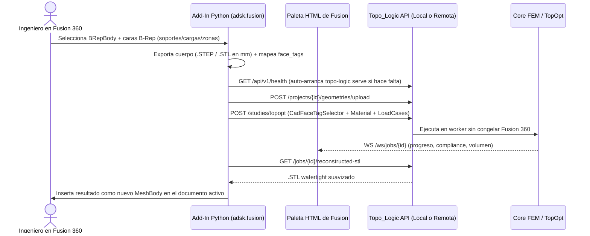

# Arquitectura de Integración Futura: Plugin de Autodesk Fusion 360 (Fase 5)

Una meta clave de `Topo_Logic` es permitir ejecutar estudios FEM y Optimización Topológica directamente dentro de **Autodesk Fusion 360** reutilizando exactamente el mismo motor numérico que la aplicación web.

---

## 1. Estrategia Elegida: Modo Híbrido vía API (`Local Daemon` o `Servidor Remoto`)

Autodesk Fusion 360 ejecuta sus Add-Ins dentro de un intérprete Python embebido gestionado por la propia aplicación CAD, donde instalar paquetes nativos compilados (`SciPy`, `NumPy` específico, `pyamg`, `scikit-image`) suele causar conflictos de ABI o bloquear la UI de Fusion.

Por ello, el futuro Add-In (`integrations/fusion360/`) será un **cliente ligero en Python (`adsk.core` / `adsk.fusion`)** que habla por HTTP/WebSocket con la API de `Topo_Logic`:

1. **Modo Local Automático:** al abrir un estudio, el Add-In comprueba `GET http://127.0.0.1:8000/api/v1/health`. Si no responde, lanza en segundo plano `topo-logic serve` apuntando al entorno Python del sistema/usuario (o ejecutable empaquetado).
2. **Modo Remoto/Cloud:** si el usuario configura una URL remota en la paleta del plugin, las mallas pesadas se resuelven en un servidor dedicado o clúster sin consumir CPU local.

---

## 2. Flujo de Interacción dentro de Fusion 360

---

## 3. Preparación Implementada desde la Fase 1

Aunque el Add-In se construirá en Fase 5, la arquitectura actual ya incluye sus pilares:
- **`CadFaceTagSelector`** en [`src/topo_logic/domain/boundary.py`](../src/topo_logic/domain/boundary.py): permite expresar soportes, cargas y zonas pasivas mediante identificadores persistentes de caras CAD en lugar de índices de triángulos.
- **Unidades y Ejes Explícitos (`mm_N_MPa`, `Z_up`):** coinciden 1:1 con el espacio de coordenadas nativo de Fusion 360.
- **CLI `topo-logic serve` y `/api/v1/health`:** permiten al Add-In descubrir y levantar el motor local con un único subproceso estándar.
